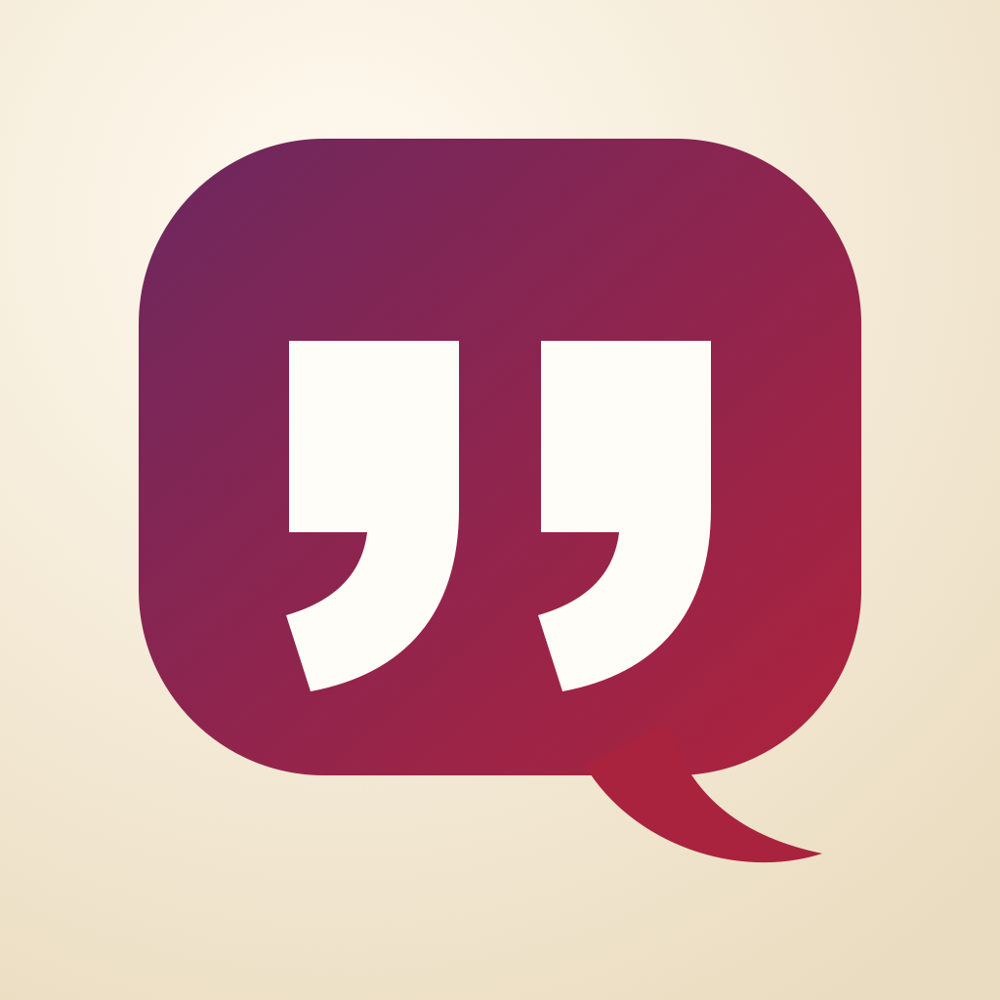

# Mameloshn

<p align="center">
  
</p>

Mameloshn is a native Apple learning app for recovering the spoken Yiddish of a family whose roots run through Bessarabia toward Odessa. The course is written entirely in Latin letters. It starts from broad Southeastern Yiddish patterns, labels uncertainty, and makes the learner's own family words part of the curriculum.

This is an early family preview. Learning progress and family words stay on the device; the app has no account, analytics, or network service. The public repository contains the source. A simple Mac download will be added after the build completes Apple notarization, while iPhone sharing will require TestFlight.

The learning loop uses short sessions, immediate feedback, visible progress, varied prompts, review scheduling, and a modest daily goal. The interface keeps calm surfaces, stable navigation, one clear action at a time, compact context, and warm direct copy.

## What works

- One SwiftUI codebase for macOS and iPhone
- Seven short lessons and roughly fifty phrases
- Meaning, listening, and recall challenges in a focused lesson session
- Broad Southeastern variants shown beside a consistent reference form
- Spaced review with Again, Good, and Easy scheduling
- A private Family Words notebook; added words enter the review deck
- Local progress, daily XP, and streak storage with no account or network service
- Approximate on-device pronunciation, clearly labeled as rough audio
- Dynamic Type-friendly adaptive layouts: sidebar on macOS and tabs on iPhone

## Run it

Mameloshn currently requires macOS 15 or iOS 18. Open `Mameloshn.xcodeproj` in Xcode 27 or later, choose the **Mameloshn** scheme, and run on **My Mac** or an iPhone simulator.

Command-line builds:

```sh
xcodebuild \
  -project Mameloshn.xcodeproj \
  -scheme Mameloshn \
  -destination 'platform=macOS' \
  -derivedDataPath /tmp/Mameloshn-mac \
  CODE_SIGNING_ALLOWED=NO build

xcodebuild \
  -project Mameloshn.xcodeproj \
  -scheme Mameloshn \
  -destination 'platform=iOS Simulator,name=iPhone 18 Pro,OS=27.0' \
  -derivedDataPath /tmp/Mameloshn-ios \
  CODE_SIGNING_ALLOWED=NO build
```

## Dialect policy

“Ukrainian Yiddish” and “Bessarabia–Odessa” describe a family geography, not one perfectly uniform dialect. The app therefore uses:

1. a consistent Latin reference form so words remain searchable and learnable;
2. carefully labeled broad Southeastern comparisons where evidence supports them;
3. the learner's exact family version as the highest-authority form once known.

The course never requires Hebrew-script literacy. Exact towns, remembered sayings, and recordings can refine it over time without rebuilding the learning system.

Useful references include the [YIVO overview of Yiddish dialects](https://www.dovidkatz.net/dovid/PDFLinguistics/2008_YIDDISH_Yivo_Encyclopedia.pdf) and the [Corpus of Spoken Yiddish in Europe user guide](https://www.yiddishcorpus.org/csye/user-guide/).

## Audio

The current `SpeechCoach` feeds hand-tuned phonetic cues to an installed Apple English voice. This is an offline prototype aid, not an authentic Yiddish voice. The UI calls it **Rough audio** and keeps it distinct from the phrase, pronunciation guide, and dialect notes.

The preferred next step is a small set of licensed human recordings from a speaker with relevant family geography. See [AUDIO_PLAN.md](AUDIO_PLAN.md) for the recording format, provenance model, source research, and fallback order.

## Project map

- `Mameloshn/Data/Curriculum.swift` — lessons, phrases, sound cues, and regional variants
- `Mameloshn/AppModel.swift` — persistence, progress, XP, review scheduling, and family words
- `Mameloshn/Views/LessonSessionView.swift` — the active learning loop
- `Mameloshn/Views/` — home, lesson library, practice, phrasebook, and family notebook
- `Mameloshn/Services/SpeechCoach.swift` — approximate offline playback

Copyright © 2026 Michael Kushman. All rights reserved.
